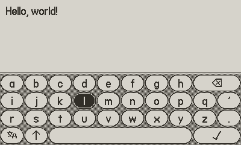

# pdkeyboard

Playdate C library for on-screen keyboards.

## Features

- Supports Latin alphabet, numbers, symbols, and Japanese kana.
- Just drop `pdkeyboard.c` and `pdkeyboard.h` into your projects, or include this repo as a submodule. No external assets required.
- [MIT license](./LICENSE).
- Dapper hand-coded C.
